### Sachin Kumar · Full-stack Developer · Competitive Programmer

I enjoy taking ideas from a clear interface to a dependable backend. My work spans product-focused web applications, APIs, data, and the engineering choices that help software stay understandable as it grows.

[LinkedIn](https://www.linkedin.com/in/sachin-kumar-486430341/) &nbsp;·&nbsp; [X](https://x.com/KumarSachin8125) &nbsp;·&nbsp; [Email](mailto:sachin2317080@gmail.com) &nbsp;·&nbsp; [GitHub](https://github.com/Sachin-8125)

---

## A little about how I build

- **Start with the experience.** Make the interface easy to follow, then connect it to the behavior and data behind it.
- **Think end to end.** I enjoy working across the client, API, authentication, and persistence layers of a product.
- **Make the system understandable.** Clear boundaries, useful errors, and explicit flows make software easier to maintain and improve.
- **Keep learning by building.** Product work and competitive programming both sharpen how I break down problems and reason about trade-offs.

## Selected work

<table>
  <tr>
    <td valign="top">
      <h3><a href="https://github.com/Sachin-8125/Citeline">Citeline</a> · Research, grounded in your library</h3>
      
An academic research assistant for uploaded PDF, DOCX, and TXT libraries. Its Gemini retrieval-augmented generation flow cites source pages and passages, with a sidecar PDF viewer for checking the evidence. The client uses React 19, Vite, and Tailwind; the Express and MongoDB server handles document workflows and JWT-based authentication.

      
<code>React 19</code> <code>Vite</code> <code>Tailwind CSS</code> <code>Express</code> <code>MongoDB</code> <code>Gemini</code> <code>JWT</code>

    </td>
  </tr>
  <tr>
    <td valign="top">
      <h3><a href="https://github.com/Sachin-8125/Flixpass">Flixpass</a> · Movie discovery to seat selection</h3>
      
A movie booking application for browsing movies and showtimes, selecting seats on an interactive map, and completing a booking. Its React client pairs with a Rust API built on Axum and Tokio; Diesel and PostgreSQL support the data layer, and Argon2 is used for password hashing.

      
<code>React 19</code> <code>Vite</code> <code>Tailwind CSS</code> <code>Rust</code> <code>Axum</code> <code>Tokio</code> <code>Diesel</code> <code>PostgreSQL</code> <code>Argon2</code>

    </td>
  </tr>
  <tr>
    <td valign="top">
      <h3><a href="https://github.com/Sachin-8125/Airlink">Airlink</a> · Authenticated, real-time messaging</h3>
      
A chat application with authenticated conversations, live messages, and media support. The React frontend uses Vite, HeroUI, Clerk, and Zustand; its Node and Express backend uses Socket.IO for real-time communication.

      
<code>React</code> <code>Vite</code> <code>HeroUI</code> <code>Clerk</code> <code>Zustand</code> <code>Node.js</code> <code>Express</code> <code>Socket.IO</code>

    </td>
  </tr>
  <tr>
    <td valign="top">
      <h3><a href="https://github.com/Sachin-8125/GPT-CLI-AGENT">GPT CLI Agent</a> · Natural language to a reviewed command</h3>
      
A Python and LangGraph command-line agent that turns a plain-language request into a Windows-compatible shell command. Its workflow generates and screens the command, pauses for human confirmation, then executes or blocks it; Docker support is included for a reproducible setup.

      
<code>Python</code> <code>OpenAI</code> <code>LangGraph</code> <code>Docker</code>

    </td>
  </tr>
</table>

## What I’m exploring

I’m learning more about **system design**, **scalable backend architectures**, and **DevOps** while continuing to build across the stack. **Competitive programming** is another way I practice breaking down problems and reasoning about efficient solutions.

## Toolbox

<table>
  <tr>
    <td valign="top">
      <h3>Client</h3>
      
<code>React</code> <code>Next.js</code> <code>TypeScript</code> <code>JavaScript</code> <code>Tailwind CSS</code> <code>Vite</code> <code>HeroUI</code> <code>Zustand</code>

    </td>
  </tr>
  <tr>
    <td valign="top">
      <h3>Server &amp; APIs</h3>
      
<code>Node.js</code> <code>Express</code> <code>Rust</code> <code>Axum</code> <code>Tokio</code> <code>Go</code> <code>Python</code> <code>Socket.IO</code>

    </td>
  </tr>
  <tr>
    <td valign="top">
      <h3>Data &amp; authentication</h3>
      
<code>PostgreSQL</code> <code>MongoDB</code> <code>Diesel</code> <code>JWT</code> <code>Clerk</code> <code>Argon2</code>

    </td>
  </tr>
  <tr>
    <td valign="top">
      <h3>AI &amp; delivery</h3>
      
<code>Gemini</code> <code>OpenAI</code> <code>LangGraph</code> <code>Docker</code> <code>GitHub Actions</code>

    </td>
  </tr>
</table>

---

*Have an interesting problem to solve?* **[Let’s connect](mailto:sachin2317080@gmail.com).**

